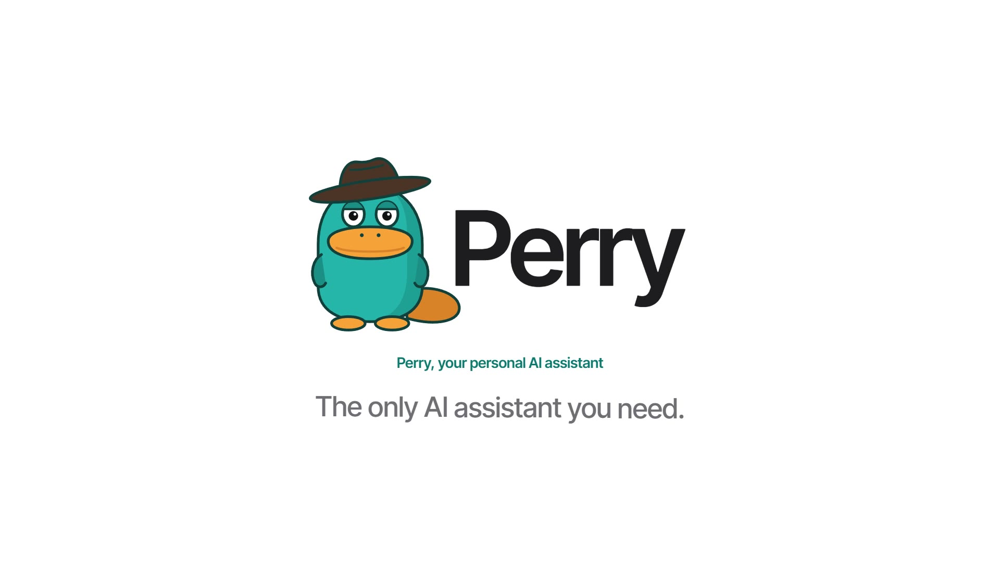

<p align="center">
  
</p>

# Perry

A personal AI assistant that runs on your computer. Chat on the web, WhatsApp or Telegram. Perry remembers your preferences, works with your files and connected accounts, and keeps track of work between conversations.

Use your own coding-agent account: Codex with ChatGPT, Claude Code with Claude, Grok Build, or Antigravity (experimental). Usage counts against the engine's plan. Optional integrations and cloud services can have their own costs.

[Install](#install) · [What's new](#whats-new) · [Setup guide](INSTALL.md) · [Download source ZIP](https://github.com/TheM1N9/perry/archive/refs/heads/main.zip) · [Report an issue](https://github.com/TheM1N9/perry/issues)

## Install

**Works on Windows, macOS and Linux.** Have an account for the engine you want Perry to use. The installer checks for the required tools, adds missing dependencies, and guides you through engine sign-in and setup.

### Windows

Paste this into **PowerShell or Command Prompt**:

```bat
powershell -c "irm https://raw.githubusercontent.com/TheM1N9/perry/main/install.ps1 | iex"
```

Open a new terminal after installation to use the `perry` command.

### macOS or Linux

Paste this into **Terminal**:

```sh
curl -fsSL https://raw.githubusercontent.com/TheM1N9/perry/main/install.sh | sh
```

The installer sets up a Git checkout in `~/perry`, installs dependencies, and opens your dashboard. Perry runs in the background and starts when you log in. Setup asks which engine to use and offers to install and sign in to it. You can skip Telegram and start with web chat alone.

Want to inspect the installer first? Read [install.ps1](install.ps1) or [install.sh](install.sh). For requirements, server setup and troubleshooting, see [INSTALL.md](INSTALL.md).

### Your first conversation

1. Open the dashboard with `perry open`.
2. Check your engine in **Settings → Engines** and choose a model for your chat.
3. Try: **“Remember that I prefer short replies”** or **“Remind me to call Sam tomorrow at 2 PM.”**
4. Connect email, calendars or other services under **Apps & skills** when you need them. Link WhatsApp or Telegram from Settings if you want to chat on your phone.

External workers can report completion with `perry notify --name <worker> --result <file>`.
Use `register_worker` in a chat, or `perry worker register`, to get a scoped final-step
command that reports back to the originating chat. See [worker webhooks](docs/workers.md).

Your computer needs to stay on and connected for Perry to answer or run scheduled work.

<details>
<summary>Install from source or on a server</summary>

For source setup, install Git, Node.js 22.13 or newer, pnpm and Bun, then run:

```sh
git clone https://github.com/TheM1N9/perry.git
cd perry
pnpm install
pnpm perry setup
```

For an unattended macOS or Linux install, choose the engine explicitly:

```sh
curl -fsSL https://raw.githubusercontent.com/TheM1N9/perry/main/install.sh | sh -s -- --engine claude
```

On Windows:

```bat
powershell -c "Set-Item Env:PERRY_ENGINE claude; irm https://raw.githubusercontent.com/TheM1N9/perry/main/install.ps1 | iex"
```

Supported engine names are `codex`, `claude`, `grok` and `antigravity`. Setup stops if an unattended install has no engine selected. See [INSTALL.md](INSTALL.md) for remote computers, network access and the optional desktop pet.

</details>

## What Perry can do

| You ask | Perry does |
| --- | --- |
| “What's on my calendar? Draft a reply to this email.” | Reads connected accounts and prepares the reply. Gmail, Google Calendar, GitHub and other integrations use [Composio](https://composio.dev). |
| “Clean up my Downloads folder.” | Works with local files and commands under the chat's access settings. |
| “Every weekday at 8, brief me on my calendar.” | Runs a scheduled job in your timezone. Reminders stay on your to-do list until completed. |
| “Tell me when this page changes.” | Watches the page and reports matching changes. |
| “Catch me up on what people are saying about AI hiring today.” | Scrolls Hacker News, Reddit, Lobsters, Google News, Product Hunt, RSS and your connected YouTube with no keys (X, TikTok and Instagram with a key you add), then groups the best posts into stories with links. A daily scroll says nothing when nothing new turned up. See [docs/scroll.md](docs/scroll.md). |
| “Research these options and come back with a recommendation.” | Runs a background task and returns its result or a specific question to the originating chat. |
| “Note this down.” | Saves an editable Brain page. Projects keep related chats and notes together. |
| “Send this to me on WhatsApp. I'll continue there.” | Sends the conversation to your paired app with a recap. |

**Perry can also start useful work.** Periodic checks of connected email and calendars can uncover something relevant to your plans or active goals. Perry can research it and prepare a concrete next step. Work shows the task, its reason and its progress. Automatic preparation stays read-only for accounts; consequential actions still need your approval.

**Decisions keep their context.** Answer a task's question in chat to continue that same task. Perry considers urgency and earlier follow-ups before asking again. You can snooze, cancel or pause work from the dashboard.

## Voice and the desktop pet

- **Talk instead of typing.** Use voice input in the dashboard or hold the desktop pet's hotkey. The pet's voice input is transcribed on your machine.
- **Write with Riff.** Open Riff from the sidebar, create a document, then dictate and ask for edits, images or links. It uses your browser's speech service, which may process audio online. Typed instructions work too.
- **Take meeting notes.** The optional pet can detect microphone activity and suggest recording. You choose when recording starts. Calendar connections help it suggest upcoming meetings. Transcription is local by default; optional Groq transcription sends audio to Groq.
- **Ask about your screen.** Show the pet your current window or let Perry look when your question needs it. The chat shows the captured picture. Screen access can be turned off in Settings.

Run `perry pet` to enable the desktop companion. Meetings and voice settings live under **Settings → Desktop pet**. See the [setup guide](INSTALL.md) for supported platforms and remote pet pairing.

## What's new

Recent changes on `main` include:

- **Scroll a topic.** Ask what people are posting about something in the last 6 hours to a week. Perry searches the platforms it can reach, remembers what it already showed you, and says which platforms are not set up.
- **Approved work continues after outside reads.** Reading a webpage or account result no longer forces another approval for an already authorized account workflow. Outside content remains untrusted, and consequential-action confirmations remain.
- **Autonomous work and decision follow-through.** Perry can start bounded preparation, keep one task for an issue and resume it when you answer. Work shows waiting decisions and follow-ups.
- **Riff voice document editing.** Dictate a document and revise it through its own editing conversation.
- **GitHub token connections.** Connect GitHub with a personal access token as an alternative to OAuth, using the permissions granted to that token.
- **Voice, meetings and recovery improvements.** Recent updates improve voice input, meeting prompts and local transcription, message delivery, interrupted work and HTTP image attachments.
- **Privacy controls.** Optional dashboard diagnostics and installer analytics are off by default.

See [merged pull requests](https://github.com/TheM1N9/perry/pulls?q=is%3Apr+is%3Amerged) for the full history.

## Everyday commands

| Command | Purpose |
| --- | --- |
| `perry open` | Open the dashboard. |
| `perry status` | Check whether Perry is running. |
| `perry logs -f` | Follow service logs. |
| `perry doctor` | Check setup and find problems. |
| `perry update` | Update and restart Perry through the supported updater. |
| `perry pet` | Start the desktop pet. |
| `perry pet off` | Turn the pet off. |
| `perry stop` / `perry start` | Stop or start Perry. |

The dashboard and pet show available updates. Perry can also update around 4 AM in your timezone when idle; control automatic updates in **Settings → General**.

## Access and privacy

**Choose access per chat:** Ask requests approval for computer actions that need it; Auto reviews requests and handles routine ones; Full access permits computer work without those approval prompts. The engine's own capabilities and settings still matter. See the [setup guide](INSTALL.md) for engine-specific behaviour.

Sending, publishing, deleting or spending still requires the appropriate owner approval. Reading outside content does not authorize new actions or let a source rewrite your preferences. Each reply has an activity trace of its tool calls and computer work.

**Your data lives on your computer.** Chats, memory, notes and attachments are kept under `~/.perry`, with SQLite as the local database. Back up that folder while Perry is stopped. Each installation has its own data; a dashboard is intended for one owner. Keep its dashboard key private.

The selected engine and connected services receive the content needed for your request. Composio manages connected-account credentials. WhatsApp uses an unofficial connection; a separate number is recommended.

Optional dashboard diagnostics are controlled in **Settings → General → Privacy** for each browser. They exclude message and file contents, credentials and session recordings. Installer analytics have a separate opt-in through `PERRY_TELEMETRY_ENABLED=1`; `PERRY_TELEMETRY_DISABLED=1` disables them.

## Need help?

Start with `perry doctor`, then check `perry logs -f`.

- **Perry won't answer:** check **Settings → Engines**, sign in to the selected engine and make sure the computer is online.
- **No default engine:** choose one in **Settings → Engines** or choose a model for the chat.
- **An integration fails:** reconnect the intended account under **Apps & skills**.
- **Installation or network trouble:** follow [INSTALL.md](INSTALL.md), or [open an issue](https://github.com/TheM1N9/perry/issues) with your OS and the error. Leave out keys and private content.

## Contributing and license

Issues and pull requests are welcome. [CONTRIBUTING.md](CONTRIBUTING.md) covers development and checks. Perry is [MIT licensed](LICENSE).

Inspired by [OpenClaw](https://github.com/openclaw/openclaw). Parts are adapted from Vercel's [eve](https://github.com/vercel/eve) under Apache 2.0; see [NOTICE](NOTICE). Voice input follows [OpenWhispr](https://github.com/OpenWhispr/openwhispr), and the desktop companion draws on [Petodo](https://www.petodoapp.com/petodo/).
