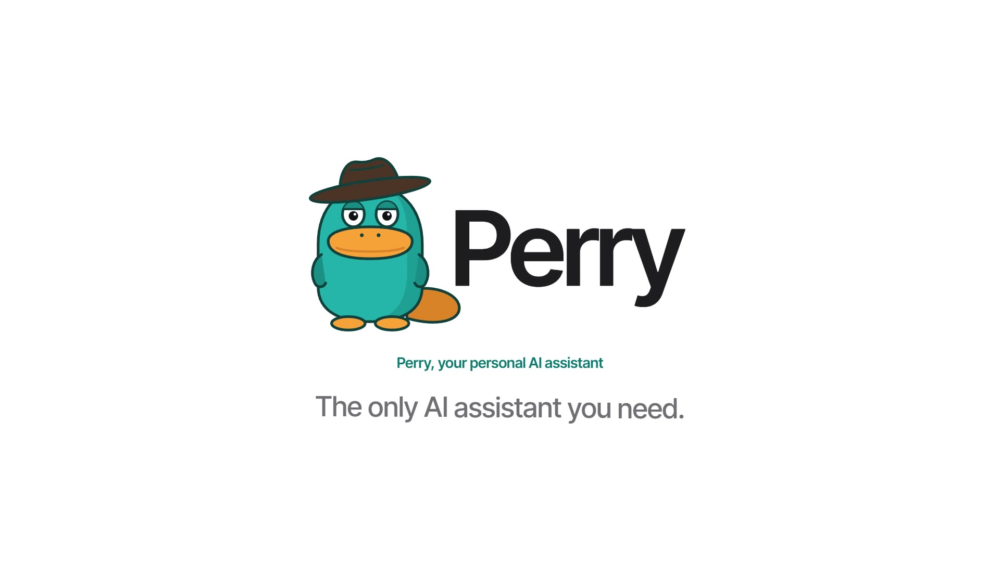

<p align="center">
  
</p>

<p align="center">
  <b>A personal AI assistant that runs on your own computer.</b><br>
  Talk to it on Telegram, WhatsApp or the web. It remembers you, works on your
  machine, and reaches your accounts, with your ChatGPT subscription as its brain.
</p>

<p align="center">
  <a href="https://perry-gamma.vercel.app">Website</a> ·
  <a href="INSTALL.md">Install guide</a> ·
  <a href="https://github.com/TheM1N9/perry/issues">Issues</a> ·
  <a href="LICENSE">MIT License</a>
</p>

---

## What it is

Perry is an assistant you install once and then just message. It thinks with
a coding agent on your own subscription, the one you choose:
[Codex](https://github.com/openai/codex) on ChatGPT,
[Claude Code](https://code.claude.com) on Claude, Grok Build on Grok, or
Antigravity (experimental) on Google. There is no API bill and no extra
account to make.

Perry runs on your computer and stores its data in a local SQLite database.
The engine and connected services you choose receive the content needed for
your requests. Optional dashboard diagnostics and installer analytics are off
by default. Anyone can run their own separate copy.

Dashboard diagnostics can be enabled in Settings > General > Privacy for that
browser. They send structural routes, feature usage, performance and error
categories to PostHog, excluding message/file contents, credentials and session
recordings. Installer milestones are separate: set `PERRY_TELEMETRY_ENABLED=1`
to opt in; `PERRY_TELEMETRY_DISABLED=1` always disables them. A custom dashboard
build may explicitly enable diagnostics with `NEXT_PUBLIC_POSTHOG_ENABLED=true`,
or force them off with `false`; public build variables take effect at build time.

## What you can do with it

- **"Remind me to call Sam at 2."** Keeps a to-do list and nudges you until
  things are done, on your phone or on your screen.
- **"Every weekday at 8, brief me on my calendar."** Runs scheduled jobs and
  one-off reminders in your timezone, and stays quiet when there is nothing new.
- **"Tell me when this page changes."** Watches web pages and lets you know.
- **"Clean up my Downloads folder."** Works on your computer, with a shell and
  your files, asking before anything outside its sandbox.
- **"What's on my calendar? Draft a reply to that email."** Connects to Gmail,
  Google Calendar, Notion and more through [Composio](https://composio.dev).
- **Notices things without a prompt.** Every half hour from 8am to 10:30pm,
  Perry checks recent activity in connected email and calendars against your
  plans and active goals. He can start research, compare options, or prepare
  a correction himself, then bring back the result or a concrete decision.
  Work → Tasks shows what he started and why. Each issue or goal keeps one
  task, with later checks continuing it rather than starting over.
  Automatic preparation reads accounts and records its work and verified goal
  milestones; your answer continues the same task
  under Ask access before sending, booking or changing accounts. Later automatic
  checks return to read-only preparation. This currently uses Codex or Claude
  Code, whose native tools can be disabled for preparation. Perry starts at most
  one task per check, two at once, and four work sessions in 24 hours. Due
  follow-through checks wait at least a day. Pause or reschedule Heartbeat under
  Work → Schedules; Pause Perry, quiet hours and notification limits still apply.
- **Follows up on unanswered decisions.** A blocked task waits for your answer,
  while Perry weighs whether another message would help, using the context,
  urgency, deadlines and earlier follow-ups. He chooses what to say and when
  to reconsider; elapsed time alone never sends a reminder. Answer
  from the web, WhatsApp or Telegram; it continues the same task. Snooze in Work
  or ask Perry to remind you later. Cancel or say to drop it to stop asking.
  Expired execution approvals become recheck requests and require fresh approval.
- **"From now on, keep replies short."** Remembers who you are, what you like
  and what you told it last week.
- **"Send this to me on WhatsApp. I'll continue there."** Sends to your own
  paired WhatsApp or Telegram, with a short recap. Your reply there continues
  in that app's existing Perry chat, with its earlier messages and the recap.
- **Reactions can be replies.** In web chat, WhatsApp and Telegram, Perry can acknowledge
  a message, express a feeling, or change a reaction as work progresses. The
  emoji choices are open to what each app supports. He can also understand
  your reaction changes and removals against the original message. Telegram
  only delivers reaction updates where the bot has the required administrator
  permissions; private-chat reaction feedback is not guaranteed.
- **"Note this: passport renewal by May."** Keeps notes you both edit: packing
  lists, trip plans, meeting notes, a weekly review a schedule adds to. A
  project's notes are shared with its chats. `/note` from your phone adds a line.
- **Think out loud in Riff.** Open it from the sidebar, create a document,
  and start listening. Dictate a draft and ask for edits, images or links while
  Perry updates it. Voice uses your browser's speech service, which may process
  audio online; typed instructions work too. Listening stops when you leave the
  page or switch tabs. Each document keeps its own editing chat and approvals.
- **Hold a hotkey and talk.** An optional desktop companion sits in a corner
  of your screen with your chats, to-dos and approvals, and takes voice input
  transcribed on your machine.
- **Take notes on calls.** Open Meetings or press Ctrl/Cmd+Shift+L with the desktop
  pet running. On Windows and macOS, microphone activity can bring up a
  Start Notetaker prompt. Connect Google Calendar or Outlook under Apps & skills,
  then use Refresh calendars in Meetings to see the next 24 hours. Perry checks
  calendars every five minutes and suggests taking notes two minutes before a
  meeting. You choose when recording starts; change the prompts in Settings →
  Desktop pet. Calendar reads use Composio's selected account for each service.
  Transcription stays local by default. In Settings → Desktop pet, choose
  Whisper Small for balanced speed or Whisper Large v3 Turbo for higher accuracy,
  and select your spoken language. Models download once. Groq cloud transcription
  is an optional mode with its own key; selecting it sends audio to Groq.
- **"What's this error?"** Another hotkey shows the companion the window
  you're in, so you can ask about it. You see the picture before it's sent.
  Perry can also look for himself when a question is about your screen, and
  the chat shows what he saw. You can turn that off in Settings → Desktop pet.

## Install

You need a Mac, Linux or Windows computer, and an account with one of the
engines above (ChatGPT for Codex, Claude for Claude Code, and so on).

macOS or Linux:

```bash
curl -fsSL https://raw.githubusercontent.com/TheM1N9/perry/main/install.sh | sh
```

Windows (Command Prompt or PowerShell):

```bat
powershell -c "irm https://raw.githubusercontent.com/TheM1N9/perry/main/install.ps1 | iex"
```

The installer adds anything missing (Node.js, pnpm, Bun), puts Perry in
`~/perry`, and walks you through setup: optionally connect a Telegram bot,
choose the engine Perry thinks with (it shows which ones are installed and
signed in, and never picks one for you), install and sign in to it, and open
the dashboard. Perry then runs in the background and starts with your
computer. Change the engine any time in Settings → Engines.

Installing where nobody can answer questions, such as a server or CI? Name
the engine: `sh -s -- --engine claude` after the `curl ... |`, or
`Set-Item Env:PERRY_ENGINE claude;` before the `irm` in the Windows line. Without it, setup
stops rather than guess.

Already cloned the repo? Run `pnpm install` and then `pnpm perry setup`.
[INSTALL.md](INSTALL.md) has the details for each OS.

## Using it

```bash
perry open      # open the dashboard
perry status    # is it running, and where
perry logs -f   # follow what it is doing
perry update    # get the latest version
perry pet       # put Perry on your desktop (perry pet off to remove)
perry doctor    # check that everything is set up right
perry stop | start | uninstall
```

Perry keeps himself up to date: when there is a new version, the dashboard and
the pet say so, one click from updating, and at night (around 4:00 your time)
he updates himself if he isn't busy. Settings → General turns that off.

Chat from the dashboard, Telegram or WhatsApp. WhatsApp is linked from the
dashboard's settings; it uses an unofficial connection, so a separate number
is recommended.

Perry answers while your computer is on. On Windows it wakes a sleeping
computer for scheduled jobs and reminders (Work → Schedules). macOS and Linux
only let an administrator set wake times, so there they wait for the computer
to wake. For an assistant that is always there, run it on a machine that
stays on, like a Mac mini or a home server.

## You stay in control

- **Approvals.** Anything beyond its sandbox is asked first, in the dashboard
  and on Telegram. "Always allow" saves a rule you can review and delete.
- **Supervised or full access**, chosen per chat.
- **Everything is logged.** Every reply has a trace of the commands, file
  changes and tool calls behind it.
- **Your data is local.** Chats, memory, notes and files live in `~/.perry`.
  Connected-account tokens are held by Composio, never by Perry.

## Contributing

Issues and pull requests are welcome. See [CONTRIBUTING.md](CONTRIBUTING.md)
for how to run Perry from source.

## Acknowledgements

Inspired by [OpenClaw](https://github.com/openclaw/openclaw). Parts of Perry
are adapted from Vercel's [eve](https://github.com/vercel/eve) (Apache 2.0; see
[NOTICE](NOTICE)). Voice input follows
[OpenWhispr](https://github.com/OpenWhispr/openwhispr), and the desktop
companion [Petodo](https://www.petodoapp.com/petodo/).

## License

[MIT](LICENSE)
